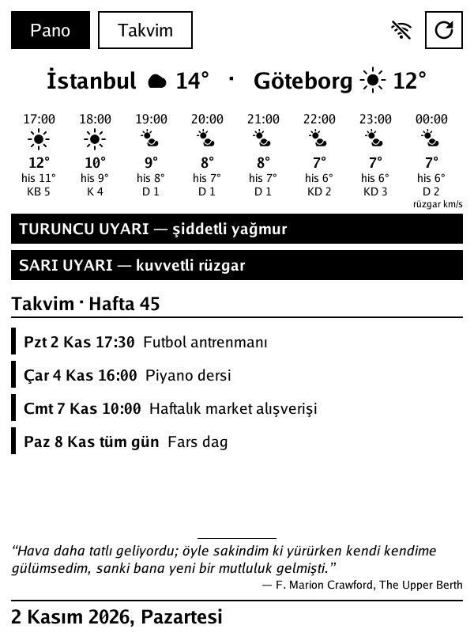

# kobo-mini-n705-dashboard

A fridge-door e-ink dashboard for the **Kobo Mini (model N705)**: weather, official weather warnings and your calendars on the 800×600 screen, hung in landscape, that sleeps between updates.

It runs as a single Go binary on the Alpine Linux base that [InkBox / Quill OS](https://github.com/Quill-OS/quill) 2.0 ships for this device. InkBox's own GUI is switched off. The Kobo fetches everything itself, no server or browser needed.



*(Screenshots use the demo calendar in `docs/demo.ics` and sample warnings. The UI language is Turkish.)*

## What it shows

One screen, calendar first:

- **The month** on the left, Monday first: bars under a date mark your own events, red days (public holidays and Sundays, as on Swedish calendars) are shaded, today is inverted. Tap a day to select it; arrows change the month, "Bugün" goes back to today.
- **The list** on the right: the selected day and every event after it, one line each (`Cmt 7  14:00  Bahar Ece Basketbol`), paged. Sources are your private ICS links plus Swedish public holidays.
- **The weather now** under the month: the home city with a large temperature and four short lines beside it: place, feels-like with the day's min/max (tomorrow's after 17:00, marked `yarın`), wind, and the next sunset or sunrise (`☀↓16:28`). Under the list, a thin strip with the next four hours. Both come from the [SMHI](https://opendata.smhi.se) point forecast (no API key; SMHI only covers the Nordics).
- **Official SMHI warnings** in the top bar, right of the date and ISO week, on one line: `Turuncu: şiddetli yağmur · Sarı: kuvvetli rüzgar`, shortened to `Turuncu: yağmur · Sarı: rüzgar` (and the month name to `Kas`) when space runs out.
- **Where it is**, unless the config names a place: the city is looked up from the public IP once a day ([geojs.io](https://www.geojs.io) and [ipwho.is](https://ipwho.is), no key). The two have to agree within 50 km, and a move further than that is only believed when a second lookup an hour later says the same, because IP databases put some ISPs in Stockholm one minute and Göteborg the next. The county found this way also picks the SMHI warnings, unless `WARN_REGION` is set.
- **One passage a day** along the bottom, on a single line with its author below: prose from public-domain novels and essays, and verse from public-domain poets, in Turkish (`kobo/quotes.tsv`).
- A top bar with the next scheduled update and battery level, Wi-Fi state (tap to pin it on) and a refresh button that also checks for a new release.

### Why it looks like this

Type sizes come from viewing distance, not taste. At 200 ppi one pixel is 0.127 mm and Go's capitals are 0.72 of the font size. ISO 9241-303 asks for at least 16 arcminutes of character height, so numbers read from 1 m need about 52 px (the temperature uses 96). Everything else is meant for reading up close at 24 px, and status text at 18. The layout follows what the best e-ink dashboards share (TRMNL, Petroff's Kindle weather display, MagInkCal): one dominant number, bands separated by rules, a capped list with "+N more", pure black on white. Go Medium/Bold beat Atkinson Hyperlegible Next and Fira Sans here because they have the largest capitals per pixel; the original Atkinson Hyperlegible has no Turkish İ.

## Power model

The device is asleep most of the time and the last frame stays on the panel (e-ink needs no power to hold it).

- Every `REFRESH_MIN` (120 by default: on battery, each wake costs a Wi-Fi association) the RTC alarm wakes it. It brings Wi-Fi up, fetches the weather (calendars every `CAL_REFRESH_MIN`, 240 by default), redraws and suspends again.
- **Quiet hours** (`QUIET`, 23-6 by default; `QUIET=off` disables them): no timed wakes at night. The alarm is set straight to 06:00, which saves a third of the daily Wi-Fi associations.
- The **power button** wakes it for `AWAKE_SEC` (120) of touch use. Pressing it while awake puts it to sleep.
- Touch can't wake the Mini from suspend: only the keypad and USB are wakeup sources.
- While awake the CPU uses the `conservative` governor (InkBox pins it at 800 MHz) and Wi-Fi is off unless needed.
- It never suspends while an ssh session is open or Wi-Fi is pinned on.

Battery life on the 1000 mAh (3.7 Wh) cell is still being measured: every sleep and wake line in the log ends with the battery level, so the drain per day can be read off `kobodash.log`. A rough estimate is a week or more at hourly updates. Measurements will be added here once there are numbers.

## Before you start

This rewrites the Kobo's internal microSD card. You keep a full backup and can always go back, but you will open the device.

You need:

- A Kobo Mini N705 and a way to open it ([iFixit teardown](https://www.ifixit.com/Guide/Kobo+Mini+Disassembly/110467)). The card sits inside under the back cover.
- A microSD card reader.
- macOS or Linux with Docker, Go (the build pins Go 1.23 through `GOTOOLCHAIN`), `xz` and an ssh key.
- The **InkBox 2.0 image for n705** from [SourceForge](https://sourceforge.net/projects/quill-os/files/n705/): `inkbox-2.0-n705.xz`, sha256 `2e103043cafe391b75d37907c25f5a5d1437f1e630008c612c882d19ff837446`.
- Your Wi-Fi name and password (2.4 GHz only; the Mini has no 5 GHz radio) and a private ICS link for your calendar.

## Step by step

### 1. Take the card out and back it up

Remove the back cover and the inner cover screws, pull the microSD card and put it in the reader. Find it by size, never by guessing the disk number:

```bash
diskutil list external physical      # macOS
lsblk                                # Linux
```

Back it up, so you can always restore the stock firmware:

```bash
sudo dd if=/dev/rdiskN of=kobo-mini-backup.img bs=4m      # macOS (Linux: /dev/sdX, bs=4M)
```

### 2. Build the image

```bash
WIFI_SSID='YourWifi' WIFI_PSK='your-password' \
  image/build.sh ~/Downloads/inkbox-2.0-n705.xz kobodash.img
```

It starts from the stock InkBox image and changes three things. The signed files stay untouched.

1. **Roots the device offline.** It writes `rooted` at sector 79872 and puts the root-compliant kernel (`uImage-root`, taken from the image's own recovery partition) at sector 81920. This is exactly what InkBox's recovery script `restore-root.sh` does. InkBox only accepts both together: one without the other makes it refuse to boot.
2. **Sets boot flags:** `X11_START=false` (no KoBox) and `RW_ROOTFS=true`.
3. **Adds files to the overlay.** The root filesystem is a signed squashfs that is verified on every boot, but `rootfs/write/` on partition 3 is the unsigned read-write branch of the unionfs on top of it. Files placed there replace the ones below. The build adds:
   - stub OpenRC scripts for `inkbox_gui`, `update_inkbox` and `ipd`, so the InkBox GUI and its power daemon stay off;
   - a `kobodash` service and a symlink that enables `sshd`;
   - your ssh public key (`PUBKEY`, default `~/.ssh/id_ed25519.pub`);
   - your Wi-Fi settings.

The script needs Docker for `e2fsprogs` and `squashfs-tools`; it builds the helper image from `image/Dockerfile` the first time. Set `SERVER=http://host:port` if you want the Kobo to report its IP to `web/server.py` on boot.

### 3. Write it to the card

macOS:

```bash
diskutil unmountDisk /dev/diskN
sudo dd if=kobodash.img of=/dev/rdiskN bs=4m && sync
sudo dd if=/dev/rdiskN bs=4m count=922 2>/dev/null | head -c "$(stat -f %z kobodash.img)" | md5     # must match: md5 kobodash.img
diskutil eject /dev/diskN
```

Linux:

```bash
sudo dd if=kobodash.img of=/dev/sdX bs=4M conv=fsync status=progress
sudo head -c "$(stat -c %s kobodash.img)" /dev/sdX | md5sum      # must match: md5sum kobodash.img
```

`count=922` is just enough 4 MiB blocks to cover the 3.87 GB image; `head -c` trims the read-back to the exact size. On macOS, run `dd` from your own Terminal. Sandboxed apps can be refused raw disk access even with sudo.

### 4. First boot

Put the card back and power on. After the InkBox boot splash you should see `kobodash`, then `Wi-Fi'ye bağlanıyor…`, then `kobodash hazır — IP: …`. The clock is set over NTP and written to the RTC.

```bash
ssh root@<kobo-ip>
```

The first boot can take a few minutes while sshd generates host keys.

Rooted InkBox ships root's password as `root` and its sshd accepts passwords, so anyone on your Wi-Fi could log in. The `kobodash` service blanks root's password on every boot (`*` in `/etc/shadow`, bind-mounted from `/tmp`), so only your key works.

### 5. Install the app

```bash
mkdir -p ~/.config/kobodash
cp kobo/dash.conf.example ~/.config/kobodash/dash.conf
chmod 600 ~/.config/kobodash/dash.conf      # it holds your private ICS link
$EDITOR ~/.config/kobodash/dash.conf
kobo/deploy.sh <kobo-ip>
```

`deploy.sh` cross-compiles for ARMv7, copies the binary and config into the overlay (it mounts partition 3 at `/tmp/p3` on the device) and restarts the app. Changes go live immediately and survive reboots; you never need to reflash for app changes. If the device is asleep, press the power button first.

### 6. Check the touch mapping

The included values (`TOUCH_SWAP=1`, `TOUCH_INVX=1`) are right for the Mini's zForce panel. If taps land in the wrong place, stop the app and run `/opt/kobodash/kobodash -calib`, tap the four corners and read the raw coordinates it prints.

The picture is drawn in landscape and turned a quarter turn onto the portrait panel. `ROTATE=cw` (default) suits the reader hung with its power button on the left; if the screen is upside down, set `ROTATE=ccw`. Taps are turned the same way, so calibration does not change.

## Updates

A device running a release build updates itself. Every `UPDATE_HOURS` (6), right after a timed refresh while Wi-Fi is up, it asks GitHub for the latest release of `UPDATE_REPO`. If the tag differs from its own version, it downloads `kobodash-armv7` and `kobodash-armv7.sig` and checks the ed25519 signature against the public key compiled into it (`kobo/update.go`, or `UPDATE_PUBKEY`). Only a binary that verifies gets installed. The private key lives on the maintainer's machine and never in the repo, so a compromised GitHub account can't push code to devices.

`supervise.sh` runs the app. The app exits after installing an update and the supervisor starts the new binary. If that binary exits with an error within a minute, the supervisor puts the previous one (`kobodash.prev`) back.

To put a device on the release track, deploy a release build once: `VERSION=v0.1.0 kobo/deploy.sh <ip>`. Builds deployed without `VERSION` report `dev` and never self-update.

To publish a release: `tools/release.sh v0.2.0` builds, signs, tags and uploads it. For your own fork, create a key with `go run ./kobo -genkey ~/.config/kobodash/release.key`, put the printed public key in `kobo/update.go` (or `UPDATE_PUBKEY`), and set `UPDATE_REPO`.

## Daily passages

`kobo/quotes.tsv` holds 220 passages: 144 sentences from novels, 38 from essays and philosophy (Stevenson, Chesterton, Emerson, Marcus Aurelius and others), 34 extracts from English poems and 4 from Yunus Emre. Religious lines, including mystic verse about the love of God, are left out on purpose. Each row has the Turkish text, author, work, the original and its source (a Project Gutenberg book number, or `ws:` for a Turkish Wikisource page). Every passage is one line on screen: long ones were cut by hand to a self-contained excerpt (the `en` column holds the matching piece of the original), and verse lines are joined with ` / `. A novel gives at most one passage and a poetry collection at most three. Every author or translator died before 1955, so the originals are public domain in the US, the EU and Turkey. The English translations into Turkish are new; Yunus Emre is shown as written.

The display shows one passage per day, the same one all day. Each year gets its own shuffle, so the order changes every year and nothing repeats until the pool runs out.

How they were chosen: `tools/quote_candidates.py` and `tools/poem_candidates.py` pulled about 11,000 likely lines out of the 6,000 most downloaded books on Project Gutenberg (novels, essays, poetry). An LLM pass kept the joyful, self-contained ones and translated them; a stricter editing pass kept only optimistic lines with real meaning, dropped anything whose source is about grief, and rewrote weak translations. `tools/verify_quotes.py` checks that every original appears word for word in its source, and `go test ./kobo` checks that each passage fits the single line the dashboard gives it.

## Development

```bash
cd kobo
GOTOOLCHAIN=go1.23.12 go build -o /tmp/kd .
/tmp/kd -conf ~/.config/kobodash/dash.conf -once out.png                      # render one frame on your desk
/tmp/kd -conf ... -once out.png -view month -now 2026-11-02T08:00 -fakewarn   # other view / date / sample warnings
```

On the device:

| Flag | What it does |
|---|---|
| `-calib` | prints raw touch coordinates |
| `-suspendtest 60` | arms the RTC alarm, suspends, and reports how long it slept |
| `-version` | prints the build version |

`go test ./kobo` runs the self-update tests against a fake GitHub (good signature installs, wrong key is rejected, same version is left alone).

`web/server.py` is the earlier browser version (stdlib Python, server-rendered HTML). It also serves `/kobo/probe`, a read-only device survey script, and accepts `/kobo/report`. It's a dev tool with no authentication: run it on a trusted LAN only.

## Things we learned the hard way

- **Go version:** the Mini runs kernel 2.6.35. Go 1.24+ needs Linux 3.2, so build with Go 1.23.
- **RTC wake:** there is no `/sys/class/rtc/rtc0/wakealarm`, so `rtcwake` refuses. Setting the alarm with the `RTC_WKALM_SET` ioctl on `/dev/rtc0` works fine.
- **Suspend:** use the Kobo sequence, `echo 1 > /sys/power/state-extended`, a short wait, then `echo mem > /sys/power/state`.
- **Timekeeping:** Go's monotonic clock stops during suspend. Keep wall-clock times (`t.Round(0)`) for anything compared across a sleep, or timer wakes look like button presses.
- **Overlay path:** the overlay's write branch is not reachable at `/rootfs-part` after `switch_root`. Mount `/dev/mmcblk0p3` yourself.
- **Touch:** zForce reports in 800×600 landscape. Screen x = 600 − raw y, screen y = raw x.
- **CPU governor:** there is no `ondemand`; the choices are `conservative`, `powersave`, `userspace` and `performance`.
- **InkBox's power daemon:** if you keep `ipd`, set `/data/config/20-sleep_daemon/7-idleSleep` to `0` to stop its auto-sleep. kobodash grabs the touch device, so ipd would think the device is idle.
- **Wi-Fi:** the interface is `eth0`. `toggle.sh off` unloads the driver and cuts its power; `connect_to_network.sh SSID PSK` connects.
- **debugfs:** `-f cmdfile` must come before the image path. Otherwise it reads commands from stdin, which silently ate the rest of a heredoc script.

## Going back

Write `kobo-mini-backup.img` back to restore the stock Kobo firmware, or the plain InkBox image for stock InkBox.

## Credits

- [InkBox / Quill OS](https://github.com/Quill-OS/quill), whose recovery scripts, init and overlay design made this possible.
- [FBInk](https://github.com/NiLuJe/FBInk) draws to the panel.
- Forecast and warnings from [SMHI open data](https://opendata.smhi.se); location from [geojs.io](https://www.geojs.io) and [ipwho.is](https://ipwho.is).
- [Go fonts](https://go.dev/blog/go-fonts) and [oksvg](https://github.com/srwiley/oksvg).

## License

MIT. Use at your own risk: this modifies your device's firmware.
